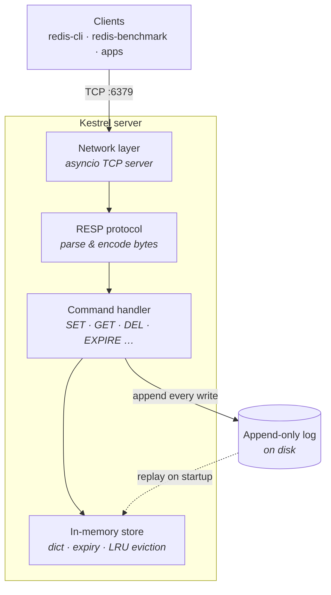
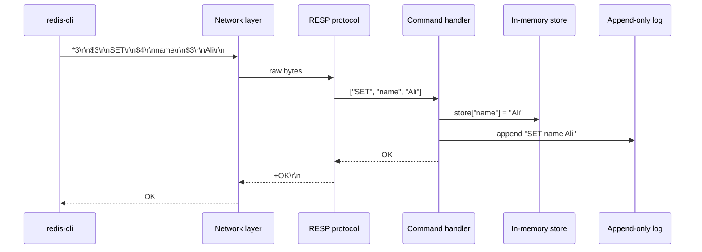

# Kestrel

**A Redis-compatible, in-memory key-value server written from scratch in Python.**

Kestrel speaks the Redis wire protocol (RESP), so the official `redis-cli` and
`redis-benchmark` tools work against it out of the box. It handles many clients
concurrently, expires keys on a timer, evicts old data when memory is full, and
recovers its data after a crash by replaying an append-only log.

I built Kestrel to understand how real backend infrastructure works under the
hood: how one server handles hundreds of clients at once, how it parses a binary
protocol off a TCP stream, and how it survives a crash without losing data. The
core is written using only the Python standard library.

> **Status:** 🚧 In active development. See the [roadmap](#roadmap) for progress.

---

## Architecture



### Request lifecycle



### Components

| Component | File | Responsibility |
|---|---|---|
| Network layer | `kestrel/server.py` | Accepts TCP connections, reads and writes bytes, one coroutine per client |
| RESP protocol | `kestrel/protocol.py` | Frames and parses RESP requests from the byte stream; encodes replies |
| Command handler | `kestrel/commands.py` | Validates arguments and dispatches each command |
| In-memory store | `kestrel/store.py` | Holds the data; handles key expiry and LRU eviction under a memory limit |
| Persistence | `kestrel/persistence.py` | Appends writes to disk and replays them on startup for crash recovery |

---

## Features

- **Redis-compatible protocol (RESP)**: works with the official `redis-cli` and client libraries
- **Concurrent clients**: asyncio event loop serving many connections on a single thread
- **Key expiry**: `EXPIRE`, `TTL` and `SET ... EX`, with lazy and active expiration
- **LRU eviction**: least-recently-used keys are evicted once a memory limit is reached
- **Crash recovery**: append-only log replayed on startup to restore state
- **Benchmarked**: thread-per-client vs. asyncio event-loop designs compared under load

### Supported commands

| Category | Commands |
|---|---|
| Connection | `PING`, `ECHO` |
| Strings | `SET`, `GET`, `DEL`, `EXISTS`, `INCR`, `DECR` |
| Expiry | `EXPIRE`, `TTL`, `PERSIST` |
| Server | `INFO`, `DBSIZE`, `FLUSHALL` |

---

## Getting started

**Requirements:** Python 3.11+. The core has no third-party dependencies.

```bash
git clone https://github.com/AliZagham1/kestrel.git
cd kestrel
python -m kestrel            # starts the server on port 6379
```

Then, in another terminal:

```bash
redis-cli -p 6379
127.0.0.1:6379> SET name Ali
OK
127.0.0.1:6379> GET name
"Ali"
```

> `redis-cli` ships with Redis: `brew install redis` (macOS) or `sudo apt install redis-tools` (Ubuntu).
> Before RESP support lands, you can also connect with `nc localhost 6379` or `telnet localhost 6379`.

---

## Benchmarks

Measured with `redis-benchmark` on _[machine specs]_.

```bash
redis-benchmark -p 6379 -c 100 -n 100000 -t set,get
```

| Design | Clients | SET ops/sec | GET ops/sec | p99 latency |
|---|---|---|---|---|
| Thread per client | 10 | _TBD_ | _TBD_ | _TBD_ |
| Thread per client | 100 | _TBD_ | _TBD_ | _TBD_ |
| Thread per client | 500 | _TBD_ | _TBD_ | _TBD_ |
| asyncio event loop | 10 | _TBD_ | _TBD_ | _TBD_ |
| asyncio event loop | 100 | _TBD_ | _TBD_ | _TBD_ |
| asyncio event loop | 500 | _TBD_ | _TBD_ | _TBD_ |

_Analysis of the results goes here._

---

## Design decisions

_A short write-up of the key tradeoffs, filled in as the project is built:_

- **Why asyncio instead of threads?**
- **How does the parser handle partial or multiple commands in one TCP read?**
- **Lazy vs. active expiry: why both?**
- **When is the append-only log flushed to disk, and what does that cost?**
- **How is LRU eviction implemented efficiently?**

---

## Testing

```bash
python -m pytest
```

---

## Project structure

```
kestrel/
├── kestrel/
│   ├── server.py         # network layer
│   ├── protocol.py       # RESP parsing and encoding
│   ├── commands.py       # command handlers
│   ├── store.py          # data store, expiry, eviction
│   └── persistence.py    # append-only log
├── tests/
├── benchmarks/
└── README.md
```

---

## Roadmap

- [ ] TCP server handling multiple concurrent clients
- [ ] Basic commands: `SET`, `GET`, `DEL`, `EXISTS`, `INCR`
- [ ] RESP protocol, compatible with `redis-cli`
- [ ] Key expiry: `EXPIRE`, `TTL`, `SET ... EX`
- [ ] Append-only log and crash recovery
- [ ] LRU eviction with a configurable memory limit
- [ ] Test suite
- [ ] Thread-per-client vs. asyncio benchmark study
- [ ] `INFO` command with server statistics

---

## Acknowledgements

Kestrel follows the [Redis protocol specification](https://redis.io/docs/latest/develop/reference/protocol-spec/).
It is a learning project and is not affiliated with Redis Ltd.

## License

[MIT](LICENSE)
